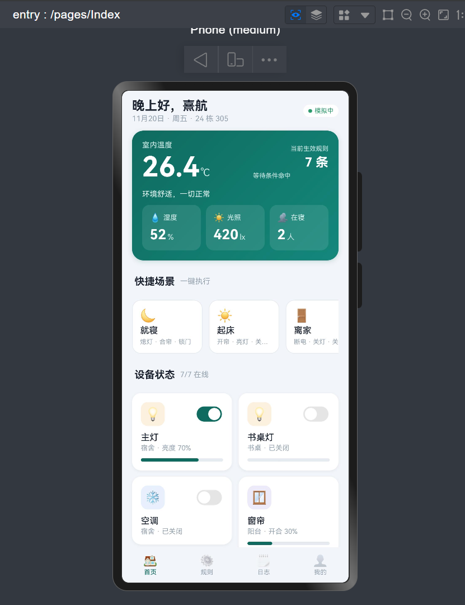
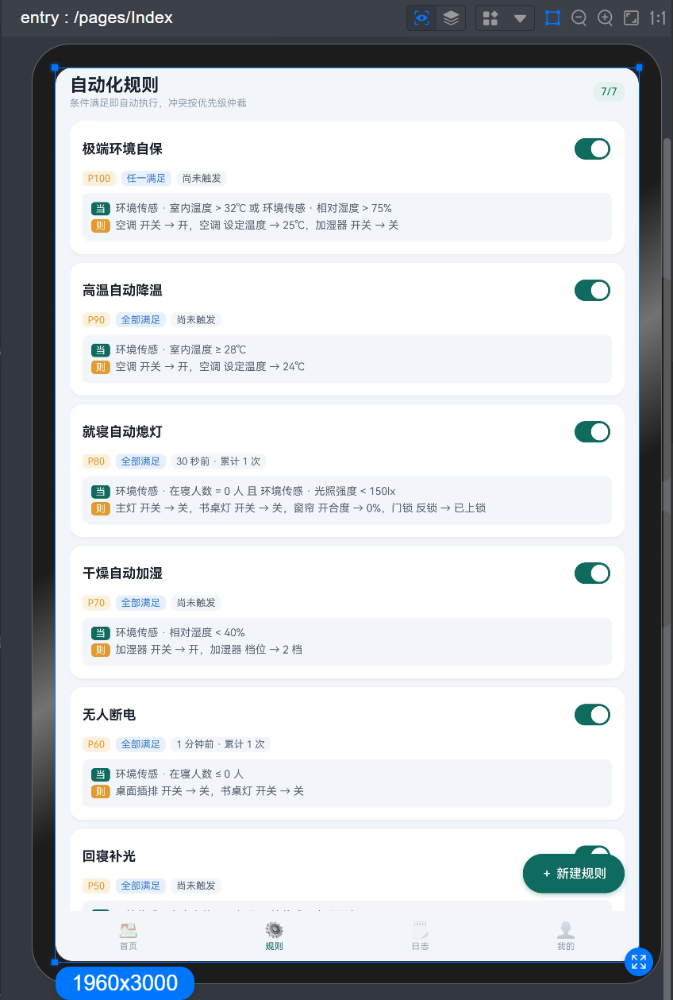
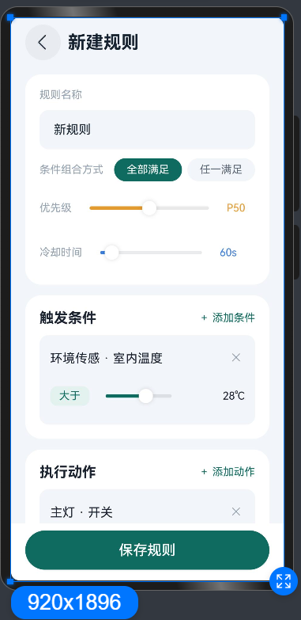
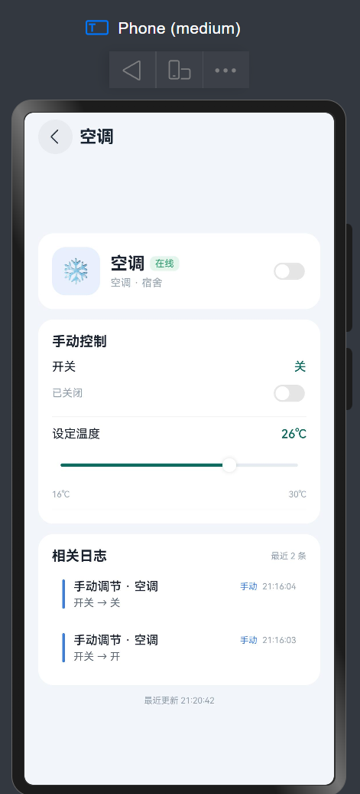
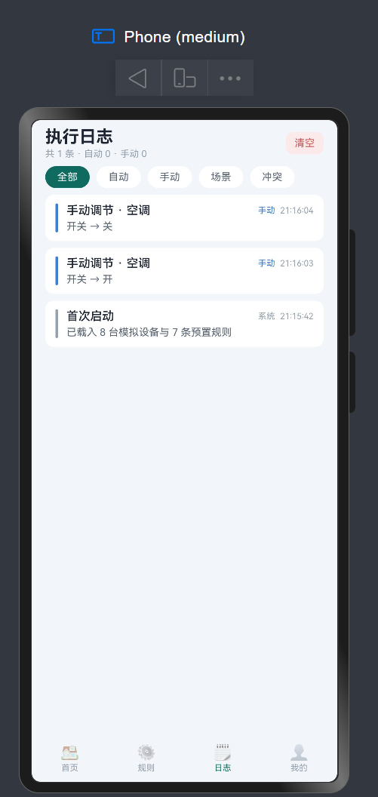
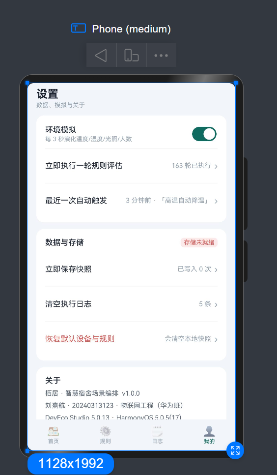

# 栖居 · 智慧宿舍场景编排

> 《移动应用开发基础》期末大作业 ｜ 主题三：智能场景规则编排与交互仿真系统
> 刘熹航 · 20240313123 · 物联网工程（华为班）24 物联 1

「栖居」把宿舍做成一个可以被**规则驱动**的小系统：环境数据在跑、规则在判、设备在动、日志在记。
不作弊的关键是——**没有人操作时，应用自己也在改变设备状态**，而这些变化能在日志里逐条核对。

---

## 一、它解决什么问题

宿舍里六类设备各自为政，人每天要重复执行"熄灯—合帘—锁门""回寝—开灯—开帘"这类组合动作；环境变热、变干需要人主动发现；即使写了联动，多条规则抢同一个设备时也会反复横跳。

本应用把设备抽象成「设备 + 属性(键值)」，用可配置的「条件 → 动作」规则统一驱动，并加入**优先级仲裁**与**冷却窗口**，让联动稳定、可解释、可追溯。

## 二、功能一览

| 模块 | 能力 |
| --- | --- |
| 环境快照 | 温度 / 湿度 / 光照 / 在寝人数，每 3 秒演化一次（Mock 随机游走，有界） |
| 设备控制 | 6 类可控设备；卡片开关、详情页滑杆/步进；每次手动操作留痕 |
| 快捷场景 | 就寝 / 起床 / 离家 / 回寝，一键写入一组动作 |
| 规则管理 | 可视化新建、编辑、启停、左滑删除；条件支持「全部满足 / 任一满足」 |
| 规则引擎 | 条件求值 → 优先级排序 → 冷却过滤 → 冲突消解 → 生成执行计划 |
| 执行日志 | 自动 / 手动 / 场景 / 冲突 / 系统五类事件，支持筛选、清空 |
| 数据持久化 | preferences 分片存储；冷启动同步恢复；切后台强制落盘 |
| 设置 | 环境模拟开关、立即评估、立即保存、恢复默认、关于 |

## 三、页面截图

> 截图存放在 `docs/images/`，录制方法见「六、运行与演示」。

| 首页 | 规则列表 | 规则编辑 |
| --- | --- | --- |
|  |  |  |

| 设备详情 | 执行日志 | 设置 |
| --- | --- | --- |
|  |  |  |

## 四、技术栈与开发环境

| 项 | 版本 / 说明 |
| --- | --- |
| 开发工具 | DevEco Studio 5.0.13.240（build DS-233.14475.28.36.5013240） |
| SDK | HarmonyOS 5.0.5（API 17），Stage 模型 |
| 构建 | Hvigor 5.17.6 + ohpm（@ohos/hypium 1.0.21） |
| 语言 / 框架 | ArkTS + ArkUI（声明式） |
| 持久化 | `@kit.ArkData` preferences（分片写入，规避 8KB 单值上限） |
| 导航 | `Navigation` + `NavPathStack` + `NavDestination` |
| 状态管理 | `@State / @Prop / @StorageLink / @Provide / @Consume` + `AppStorage` |
| 能力 | `UIAbility` 生命周期、`AbilityKit` Context、`promptAction`、`AlertDialog` |

## 五、工程结构

```
Qiju/
├─ AppScope/                       应用级配置（bundleName: com.qiju.smartdorm）
├─ docs/
│  ├─ 软件需求说明书.md             需求、架构、接口、数据结构、存储设计
│  └─ images/                      运行截图（README 引用）
├─ entry/src/main/ets/
│  ├─ entryability/EntryAbility.ets 启动恢复 / 前后台节拍与落盘
│  ├─ common/                      Theme(设计规范) Formats Visuals Route
│  ├─ model/                       Device Rule LogEntry Scene RulePresets PropCatalog
│  ├─ service/                     RuleEngine(纯逻辑) AutomationService EnvSimulator
│  ├─ data/                        AppRepository(分片持久化) SnapshotCodec(DTO)
│  ├─ store/HomeStore.ets          唯一状态源：业务动作、节拍、通知、持久化
│  ├─ view/                        DeviceCard ScenePill RuleCard LogRow Widgets
│  └─ pages/                       Index + tabs/{Home,Rules,Logs,Settings}
│                                  DeviceDetailPage RuleEditPage(NavDestination)
├─ entry/src/test/                 本地单元测试（15 个用例，PC 端运行）
└─ entry/src/ohosTest/             设备侧测试（3 个用例，真机/模拟器运行）
```

## 六、运行与演示

### 6.1 用 DevEco Studio 运行

1. `File → Open` 选择本仓库根目录（含 `build-profile.json5` 的目录）；
2. 等待 Hvigor Sync 完成（首次会下载依赖，需联网）；
3. `File → Project Structure → Signing Configs` 勾选自动签名（需登录华为账号）；
4. 选择真机或模拟器，点击 Run。

### 6.2 命令行编译（免签名的产物验证）

```bash
# 需先把 DevEco 自带的 node 加入 PATH
hvigorw --mode module -p product=default -p module=entry@default assembleHap --no-daemon
# 产物：entry/build/default/outputs/default/entry-default-unsigned.hap
```

### 6.3 跑单元测试

- 本地单元测试（无需设备）：`entry/src/test/RuleEngine.test.ets`，在 DevEco 中右键 `Run`，或在测试面板运行 `testsuite`。
- 设备侧测试：`entry/src/ohosTest/ets/test/RuleEngine.test.ets`，连真机后运行。

### 6.4 演示录屏（3—5 分钟建议脚本）

1. 首页停留 10 秒：环境数值在跳、设备状态自动变化；
2. 打开日志页：展示"自动执行"记录与冲突消解记录；
3. 进规则页 → 编辑一条规则（把阈值改小）→ 保存 → 回首页等它命中；
4. 关掉应用（后台清理）→ 重新打开 → 证明数据还在；
5. 结束。

> 录屏文件：`docs/record/qiju-demo.mp4`（或附 B 站/网盘链接）

## 七、规则引擎设计（核心）

```
buildPlan(rules, devices, now):
  1. 规则按 priority 降序、id 升序排序        → 结果确定，不依赖遍历顺序
  2. 逐条求值：ALL / ANY + 缺失设备按不满足      → 不抛异常
  3. 冷却窗口内跳过，记 blocked(原因)
  4. 动作写入前检查：设备存在 / 可写 / 属性存在   → 传感器只读，拒绝写入
  5. 同一 device#prop 已被更高优先级占用 → conflicts(让位)
  6. 产出一份 ExecutionPlan，由 HomeStore 落库并写日志
```

关键取舍：
- **引擎是纯函数**（不碰 UI、不碰存储），因此 15 个 hypium 用例可以覆盖正常 / 边界 / 异常，不依赖设备；
- **冲突消解而不是简单覆盖**：让"规则打架"这件事在界面上可解释，而不是表现为随机的状态抖动；
- **冷却窗口**：避免同一规则每 3 秒重复写同一动作导致日志刷屏。

## 八、测试覆盖

| 类别 | 用例数 | 关注点 |
| --- | --- | --- |
| 正常 | 5 | 比较语义、ALL/ANY、高温触发、动作写回 |
| 边界 | 5 | 浮点容差、空条件、冷却临界、数值夹紧、模拟区间 |
| 异常 | 5 | 设备缺失、写只读传感器、非法规则校验、空规则集、优先级抢占 |

本地 15 个用例全部通过后，设备侧另跑 3 个回归用例，验证真机环境行为一致。

## 九、已知限制

1. 设备为 Mock，不接入真实硬件；环境模拟是随机游走，非物理模型。
2. 未做多用户/云同步；数据仅保存在本机 preferences。
3. 规则只支持"属性比较"这一种条件形态，暂不支持时间段、星期、持续时间等时间维度条件。

## 十、作者

刘熹航（20240313123），物联网工程（华为班）24 物联 1。
本仓库为《移动应用开发基础》期末大作业个人作品，独立完成。
